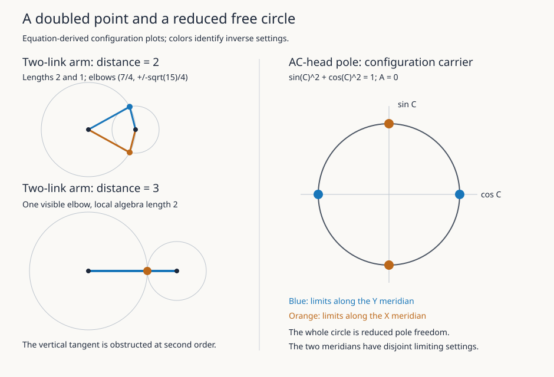

# Exact CNC constraint experiments

The [worked models](../../../notes/cnc-constraint-fibers.md),
[linkage/offset note](../../../notes/cnc-linkage-and-offsets.md) and
[source map](../cnc-source-map.md) give meaning and hypotheses.

| Input | Scope | Observed result |
| --- | --- | --- |
| `case-a-arm.m2` | Original circle ideals at distances 1,2,3,4; radical, tangent, degree, family identities, second-order obstruction and cone chart | PASS |
| `case-b-ac-head.m2` | Original pose fibers; reduced pole; two-point nearby fiber; minors; saturation; disjoint limiting settings | PASS |
| `linkage-and-offset.m2` | Three-rod tangent and quadratic cone; regular offset crossing; residual divided differences | PASS |
| `diagram.m2` | Equation-derived vector figure | Generated and visually inspected |

The figure draws real support, not nilpotent thickness. Its pole circle is
in (cos C,sin C) configuration coordinates, not a physical tool-tip circle.
Display coordinates use a common scale within each arm panel; the two panels
use different scales. The nonrational elbow height is approximated only
for rendering.

## Execution provenance

Actual host: disposable Ubuntu 24.04.3, Linux x86_64. Macaulay2 1.22 came
from Ubuntu `macaulay2` and `macaulay2-common` version `1.22+ds-6build2`,
with their shared-library dependencies. Packages were extracted, not built.
Native executable SHA-256:
`abc09b6bc62746ad8913a5089a6ee271fc2e217e0bc43d941937b2574ad1dcb4`.
Distribution archive digests:

    macaulay2:        7bf62644091fce9677728bafd9cbec91509b1a210dab9f0294721a27ce73651a
    macaulay2-common: e2f5acb693cb11198114a323621d10c9f6f01084d8ff07c8aed37732cbe186dd
    singular-data:   162f83de2e1acc19d1db7d15323b6c3b617183f91cabff0f48e4b65b36114558

The distribution assumed `/usr/share/singular/factory/`. Its foreign
`Core/factor.m2` was changed only to point `gfdirs` to the extracted Factory
table directory. No algebra algorithm was replaced. Exact argv, relocation
digest, source hashes, stdout/stderr and pipeline identity accompany receipts.
A normal installed M2 needs no relocation. Initial truncated downloads were
rejected and redownloaded; resulting segmentation failures are provisioning
evidence, not model results. A multiline-expression error and a constant-
substitution ring mismatch were repaired before the retained passing runs.

Run each input with the actual `M2 --script` entrypoint and an absolute input
path on a verified algebra host. The diagram also takes an absolute output
SVG path. These are interpreted calculations; no maintained compile/link
stage is introduced. Later numerical implementation retains C ownership and
the ICK-or-NDK build rule; Grease owns shell orchestration and Macaulay2 algebra.

## Independent acceptance and limits

The separate ai-ci oracle recomputes analytic circle identities, checks a
non-meridian pole setting and the regular offset crossing, and checks actual
producer transcript fields. Its positive record passes. Seventeen false
records each fail at their declared first diagnostic. These mutate specific
result claims; they are not assertions that upstream Macaulay2 is faulty.
Input/output digests accompany results; saved good output cannot accept a
changed producer source.

This bounded host evidence does not independently prove every paragraph,
validate the five-rod full ideal by computer, qualify an algebra-process
protocol, prove real machine motion, or establish superiority over analytic
continuation. Chain reducedness and tolerance-area asymptotics use the
analytic proofs in the note. Controller, holder and compliance evidence is
NOT_VERIFIED.

Flexible Pipes owns staged command receipts; ai-ci owns independent result
and delivery rejection. Its delivery regression suite passed 41 cases through
workflow-pinned checked Ithon. No trusted ChatGPT sink is deployed: offline
response-byte checks and platform delivery attestations remain distinct.

## Algebra source supplement

The Eisenbud–Harris institutional PDF's §II.3.1, Example II-9 (printed p. 58,
PDF index 65), distinguishes a double point from its reduction. §II.3.4
(pp. 70–79) treats limits and flatness; §V.3.1 (pp. 230–231) uses differentials
for singular morphisms. These passages were read; the book is not mirrored.
